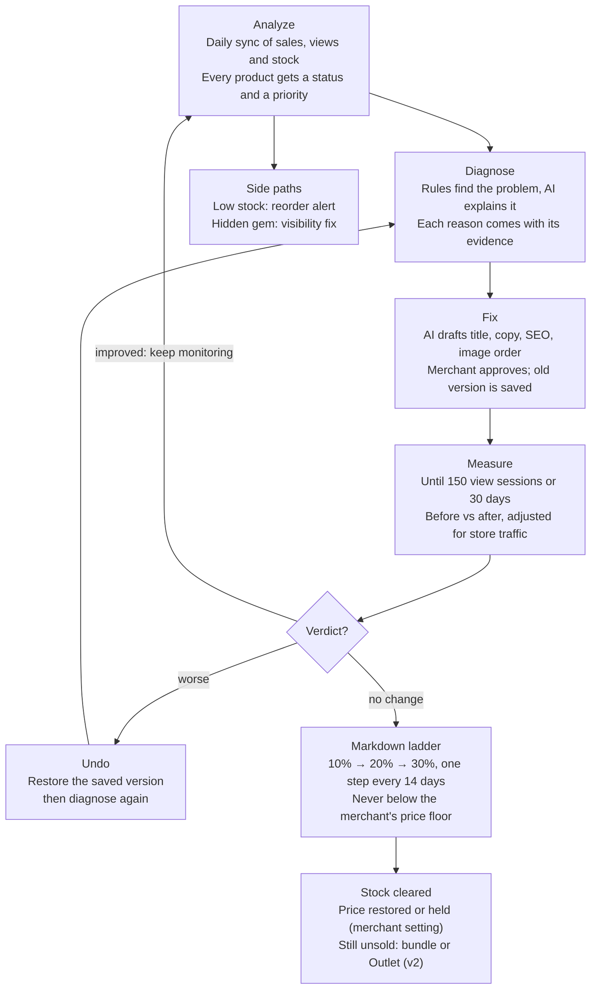
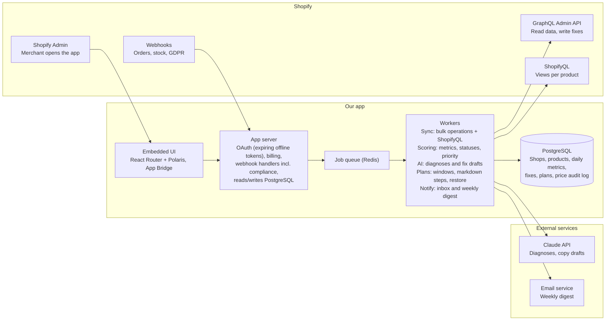

# Shopify Product Analyzer — Development Plan

Oct 24, 2026 · Gezart

## Summary

We build a Shopify app that takes every underperforming product through one loop: analyze its sales, diagnose why it is not selling, apply fixes, measure the effect, and discount only as the last step. The app proves its value by showing the money it recovered.

| Item | Decision |
| --- | --- |
| Product | Embedded Shopify app (inside Shopify Admin), sold on the Shopify App Store |
| Working name | Unstuck — App Store listing "Unstuck: Product Analyzer" (candidate; confirm domain and trademark) |
| Promise | "Find the products that don't sell, learn why, fix them, and discount only what can't be saved." |
| Target merchants | Stores with 50–2,000 products and physical stock: fashion, home, accessories, beauty, gifts |
| Not for | Single-product stores, dropshipping-only stores, Shopify Plus enterprises (later) |
| Differentiator | The full loop in one app, with before/after measurement and a "money recovered" number |
| Revenue model | Monthly subscription through Shopify Billing, free plan for small catalogs |
| 12-month target | 200 paying stores, about $5,800 MRR at a $29 average |
| Build team | Gezart + the AI agent team (see Technical architecture) |

Three rules shape every feature: value on day one from existing sales history, the merchant approves every change, and every change can be undone.

## Competitive landscape

Every step of our loop exists as a separate app, but none we found runs the whole loop. Most competitors launched in 2026 and have 0–3 reviews, so the category has no leader yet.

| Step | Existing apps | What they do | What they miss |
| --- | --- | --- | --- |
| Analyze | [Skymetrics](https://skymetrics.co/product-analytics), [Conjura](https://open.store/shopify-apps/conjura-app), Shopify's own reports ([Analyzify guide](https://analyzify.com/hub/product-performance-analysis-with-shopify-analytics)) | Conversion and revenue per product, promotion and discount suggestions, sales by product, ABC analysis | Numbers without the reason, no follow-up |
| Diagnose | [Why Aren't They Buying?](https://appnavigator.io/app/first-impressions), [Velora](https://pickyourapp.com/products/velora-1), [Ventry AI](https://pickyourapp.com/de/products/ventry-ai-conversions-booster), [EcomHint](https://www.producthunt.com/p/ecomhint) | AI reviews the product page and lists objections, sometimes rewrites copy | No sales or stock context, no measurement after the fix |
| Fix and measure | [Cartalyst](https://pickyourapp.com/products/cartalyst) ($15/month, launched July 2026) | Prioritized fixes with directional before/after results | Store-wide, not a per-product lifecycle, no markdown step |
| Test | [Intelligems](https://apps.shopify.com/intelligems) (from $49/month), Shoplift | Statistical A/B tests on prices, content, templates | Needs high traffic, priced for larger brands |
| Discount | [Sale House](https://apps.shopify.com/sale-house) (free), [Driftmark](https://apps.shopify.com/driftmark), [ClearStock](https://apps.shopify.com/clearstock), [Shelfie](https://apps.shopify.com/shelfie-1), [Dead Stock Clearance](https://apps.shopify.com/dead-stock-clearance) ($29.99/month) | Detect slow movers, gradual markdowns, margin floors, auto-restore | Discount first, never ask why the product doesn't sell |

**Our gap:** a small merchant today needs three or four of these apps to do what our loop does. The risk is that one of them adds the missing steps, so speed to a working loop matters more than feature count.

## Core workflow

Every product that isn't healthy goes through the same loop, and a discount happens only after a measured fix changed nothing.

A worse result is undone and diagnosed again; an improved product goes back to daily monitoring. Low-stock products get a reorder alert, and hidden gems skip straight to a visibility fix.

## Feature specification

The MVP ships all twelve modules in a basic form; the loop must work end to end before any module gets deep. "Done when" is the acceptance test for the MVP version.

| # | Module | MVP (v1) | Later (v2+) | Done when |
| --- | --- | --- | --- | --- |
| 1 | Onboarding and sync | OAuth install, plan pick, initial sync of products, variants, inventory, 60 days of orders and per-product view data; progress bar; webhooks keep data fresh | Full order history (after `read_all_orders` approval), multi-location inventory, cost import from CSV | A 2,000-product store is fully analyzed within 10 minutes of install |
| 2 | Catalog health dashboard | "Money stuck in stock" headline, products grouped by status, top 10 to act on today | Trends over time, collection-level health, saved views | Merchant sees value on the first screen without any setup |
| 3 | Product analysis | Per product: units, revenue, views, view-to-cart and view-to-purchase rates, stock, days of cover, last sale, 30/60/90-day trend | Variant-level analysis, traffic sources, seasonality detection | Every number on the page matches Shopify's own reports within 2% |
| 4 | AI diagnosis | Ranked reasons a product isn't selling, each with evidence (e.g. "price 34% above similar products in this collection") | Storefront screenshot review, review/rating signals, competitor price check | Each reason links to the data that triggered it; no reason without evidence |
| 5 | Fix center | AI suggestions for title, description, SEO title/meta, image order, collection placement; merchant approves each; app applies via Admin API; old version saved; one-click undo | Bulk fixes, image alt text, AI image enhancement, translated copy | Applying and undoing a fix leaves the product exactly as before |
| 6 | Rescue plans (measure) | After a fix, the product enters a measurement window; before/after comparison of views, conversion, units; verdict: improved / no change / worse | Holdout comparison against similar products, confidence scores | Verdict is shown with the window dates and the numbers behind it |
| 7 | Markdown engine | If a rescue plan ends with "no change", propose a stepped discount (compare-at price) within a margin floor and a max discount; merchant approves the schedule; auto-restore when stock clears or the plan ends | Bundles with best sellers, gift-with-purchase, "Outlet" collection, automatic discounts | No price ever goes below the merchant's floor; every price change is logged |
| 8 | Reports | Monthly report: products rescued, revenue recovered, stock value cleared, fixes applied and their effect | Scheduled email/PDF reports, agency multi-store reports | Revenue recovered is calculated by a documented formula |
| 9 | Compare products | Pick 2–4 products, side by side: sales, views, conversion, price, margin, stock age, page quality score | Compare collections, compare periods, compare to category benchmarks | Compare view loads in under 2 seconds |
| 10 | Settings and rules | Thresholds (days without sale, minimum views), margin floor, max discount, products/collections to exclude | Custom rules builder, per-collection rules | Changing a threshold re-scores the catalog within 1 minute |
| 11 | Notifications | In-app inbox; weekly email digest with the top 5 actions | Slack/WhatsApp alerts, real-time alerts for stock-outs | Digest goes out weekly and links straight to each action |
| 12 | Billing and plans | Free and paid plans through Shopify Billing; usage limits enforced | Usage-based "pay on recovered revenue" plan, annual plans | Upgrade, downgrade and uninstall all work with no manual steps |

**Out of scope for v1:** A/B testing with split traffic, theme edits, storefront widgets, ad platform integrations.

## Analysis logic

Thresholds are relative to each store's own medians, not fixed numbers, because a "high" view count in a small store is low in a large one. Rules find the problem; AI only explains it and drafts the fix.

### Core metrics (per product, 30/60/90-day windows)

| Metric | Formula / source |
| --- | --- |
| Units sold, revenue | Order line items |
| View sessions | ShopifyQL `view_sessions` (sessions where the product was viewed) |
| View-to-cart rate | ShopifyQL `view_to_cart_rate` |
| Conversion | ShopifyQL `view_to_purchase_rate` |
| Sell-through | units sold ÷ (units sold + units in stock) |
| Days of cover | units in stock ÷ average daily units (last 30 days) |
| Stock value | units in stock × unit cost (Shopify cost field; price × 0.5 when cost is missing, flagged as estimate) |
| Days since last sale | today − date of last order containing the product |
| Trend | units last 30 days ÷ units previous 30 days |

### Product statuses

| Status | Rule (defaults, editable) | Next action |
| --- | --- | --- |
| Page problem | Views in top 40% of store, conversion below 50% of store median | Diagnose the page, apply fixes |
| Hidden gem | Views in bottom 40%, conversion above store median | Raise visibility: collections, homepage, menu |
| Slow mover | Sell-through under 20% in 60 days, still selling | Diagnose, then rescue plan |
| Dead stock | No sale in 90 days, stock > 0 | Short rescue plan, then markdown |
| Stock-out risk | Days of cover under 14 and trend ≥ 1 | Reorder alert |
| Healthy | None of the above | Nothing |

The action list is sorted by **money at stake** = stock value × status weight (dead 1.0, slow 0.7, page problem 0.6, hidden gem 0.4).

### Diagnosis rules (v1)

- Price more than 25% above the median of the same collection or product type
- Fewer than 3 images, or first image not a product shot (AI vision check)
- Description under 80 words, missing size/material/use details, or duplicated from another product
- Missing SEO title or meta description
- Key sizes or variants out of stock (broken size run)
- Not in any collection, or only in collections with low traffic
- High view-to-cart but low purchase → flag store-level issue (shipping cost, checkout), not the product

### Measurement window (rescue plan)

1. The window starts the day a fix is applied.
2. It ends at 150 view sessions or 30 days, whichever comes first, and never before 14 days.
3. Baseline = the same number of days before the fix, adjusted by the change in store-wide sessions (removes seasonality and ad bursts).
4. Verdict: improved if conversion rises 20%+ and units rise; worse if conversion falls 20%+; otherwise no change. Under 50 view sessions = "not enough data", window extends once.
5. Worse → offer one-click undo.

### Markdown ladder

- Default steps: 10% → 20% → 30%, one step every 14 days, using compare-at price so the storefront shows the saving.
- Hard limits: price never below cost × (1 + minimum margin), default minimum margin 10%; maximum discount default 40%.
- Stop when 50% of the stock at plan start is sold, then restore or hold the price (merchant setting).
- Ladder ends unsold → suggest bundle or Outlet (v2), or mark "consider delisting".

### Revenue recovered (shown in reports)

Revenue recovered = actual revenue during the rescue or markdown period − (baseline daily revenue × days in the period), floored at 0. The formula is shown in the app next to every number.

## Technical architecture

One TypeScript codebase: an embedded admin app, an app server, and background workers that do all syncing, scoring, AI and price changes. The UI never calls Shopify or the AI directly.

Webhooks and the UI enter through the app server; everything heavy goes through the job queue to the workers, which read Shopify, call Claude and write to PostgreSQL.

### Stack

| Layer | Choice | Why |
| --- | --- | --- |
| Embedded app | Shopify React Router template, Polaris, App Bridge | Auth, billing helpers, webhooks and session tokens built in; the look Built for Shopify expects |
| Language | TypeScript end to end | One language for UI, server and workers |
| Database | PostgreSQL with Prisma | Relational data, migrations, strong constraints for the price floor |
| Queue | Redis + BullMQ | Retries, schedules, rate-limit control per store |
| AI | Claude API: Sonnet for diagnosis and copy, Haiku for bulk work | Quality where the merchant reads it, low cost for volume |
| Email | Transactional email service (e.g. Resend or Postmark) | Weekly digest |
| Hosting | Always-on host for web + workers (e.g. Railway or Render) | Workers must run 24/7 |
| Monitoring | Error tracking (e.g. Sentry), uptime check, price-guard alert | A wrong price is the worst bug |
| Marketing site | Next.js + Tailwind | Team default stack |
| QA | customer-tester agent + unit tests on scoring, verdicts and price floor | The money logic is tested in code, the flows by the agent |

### Background jobs

| Job | Trigger | What it does |
| --- | --- | --- |
| Initial sync | App install | Bulk operations for products, variants, stock; 60 days of orders; 90 days of per-product views via ShopifyQL |
| Live sync | `orders/create`, `products/update`, `inventory_levels/update` webhooks | Keeps rows fresh within minutes |
| Daily metrics | Nightly, in the store's timezone | Writes `product_daily_metrics`, recomputes statuses and money at stake |
| Diagnosis | On demand, and when a product turns slow or dead | Rules first, then AI; cached until the product or its metrics change |
| Plan runner | Hourly | Closes measurement windows, sets verdicts, applies approved markdown steps, restores prices |
| Price guard | After every price write, and daily | Confirms no price is below the floor; alerts and reverts if one is |
| Digest | Weekly, on the merchant's chosen day | Inbox items and email with the top 5 actions |
| Uninstall and redact | `app/uninstalled`, `shop/redact` | Stops all jobs for the store; deletes its data as compliance requires |

### AI layer rules

- Input is structured facts only: product fields, collection medians, metrics and the rule hits. Output is JSON: reasons (code, evidence, severity) and drafts.
- The AI never invents materials, sizes or specs; missing facts come back as "needs merchant input".
- Drafts are written in the store's primary language, with length limits per field.
- Every diagnosis and draft stores its model version; token use is logged to `ai_usage` and capped by plan.

## Data model

PostgreSQL, one schema, every table keyed by `shop_id` so one store can never read another store's rows. Daily metrics are stored as snapshots, which is what makes before/after comparisons possible.

| Table | Key fields | Purpose |
| --- | --- | --- |
| `shops` | id, domain, access_token (encrypted), plan, installed_at, uninstalled_at, currency, timezone | One row per store |
| `settings` | shop_id, thresholds (JSON), margin_floor_pct, max_discount_pct, excluded_collection_ids, digest_day | Merchant rules |
| `products` | id, shop_id, shopify_gid, title, handle, product_type, vendor, collections[], image_count, description_words, price, compare_at_price, cost, status, updated_at | Latest product state |
| `variants` | id, product_id, shopify_gid, sku, option values, price, cost, inventory_qty | Size/colour level stock |
| `product_daily_metrics` | product_id, date, units, revenue, view_sessions, cart_sessions, purchase_sessions, inventory_qty | Daily snapshot, the base of every chart and comparison |
| `product_scores` | product_id, computed_at, status, money_at_stake, sell_through, days_of_cover, trend | Current status and priority |
| `diagnoses` | id, product_id, created_at, reasons (JSON: code, evidence, severity), ai_summary, model_version | Why it isn't selling |
| `fixes` | id, product_id, diagnosis_id, type (title, description, seo, images, collection), before (JSON), after (JSON), status (suggested, approved, applied, undone), applied_at | Every change, with a full snapshot for undo |
| `rescue_plans` | id, product_id, fix_ids[], started_at, ends_at, baseline (JSON), result (JSON), verdict | Measurement window and verdict |
| `markdown_plans` | id, product_id, rescue_plan_id, steps (JSON), floor_price, max_discount_pct, status, started_at, ended_at | Approved discount ladder |
| `price_changes` | id, product_id, variant_id, old_price, new_price, old_compare_at, new_compare_at, reason, plan_id, changed_at | Audit log of every price change |
| `reports` | id, shop_id, period, revenue_recovered, stock_value_cleared, products_rescued, payload (JSON) | Monthly reports |
| `notifications` | id, shop_id, type, product_id, read_at, created_at | In-app inbox and digest |
| `sync_state` | shop_id, resource, last_cursor, last_synced_at, status, error | Resumable sync and webhook health |
| `ai_usage` | shop_id, month, calls, input_tokens, output_tokens, cost_usd | AI cost per store, enforced against plan limits |

Customer names, emails and addresses are never stored: the order sync keeps only date, product, variant, quantity and price.

## Shopify platform requirements

The five hard gates for App Store approval are: GraphQL Admin API, Shopify Billing for every charge, the three compliance webhooks, protected customer data approval, and a clean install/uninstall. All five are built in Phase 0–1, not at the end.

### Access scopes

| Scope | Why we need it | Note |
| --- | --- | --- |
| `read_products`, `write_products` | Read the catalog, apply fixes and price changes | |
| `read_inventory` | Stock levels, days of cover | |
| `read_orders` | Sales per product | Default window is the last 60 days ([Shopify scopes](https://shopify.dev/docs/api/usage/access-scopes)) |
| `read_all_orders` | Full sales history for better baselines | Must be requested and approved in the Partner Dashboard; v2 ([Shopify scopes](https://shopify.dev/docs/api/usage/access-scopes)) |
| ShopifyQL analytics access | Per-product `view_sessions`, cart and purchase rates, with history | Exact scope to confirm in the Phase 0 spike ([products dataset](https://shopify.dev/api/shopifyql/datasets/products-dataset)) |
| `write_discounts` | Automatic discounts and bundles | v2 only |

### Platform rules we design for

| Requirement | What we do | Source |
| --- | --- | --- |
| New public apps use the GraphQL Admin API | GraphQL only, bulk operations for the initial sync | [Unified.to guide](https://docs.unified.to/skills/shopify-oauth-app/SKILL.md) |
| Expiring offline access tokens (mandatory for new public apps since 1 April 2026) | Token refresh handled in the session layer | [Unified.to guide](https://docs.unified.to/skills/shopify-oauth-app/SKILL.md) |
| Protected customer data approval (separate from App Store review) | Request access, store no customer PII, document retention | [Unified.to guide](https://docs.unified.to/skills/shopify-oauth-app/SKILL.md) |
| Compliance webhooks `customers/data_request`, `customers/redact`, `shop/redact`; invalid HMAC returns 401 | Implemented and tested before submission; `shop/redact` deletes all shop rows | [Shopify docs](https://shopify.dev/apps/webhooks/mandatory) |
| Every charge through Shopify Billing | Plans via Billing API; usage plan uses a capped amount per 30-day cycle | [Usage-based billing](https://shopify.dev/docs/apps/billing/subscriptions/usage-based), [review guide](https://taylorsicard.com/blog/shopify-app-store-review-rejected) |
| App name without "Shopify" | Brand name chosen with this rule | [Apideck guide](https://apideck.com/blog/how-to-create-a-shopify-public-oauth-app) |
| Review can take up to two weeks | Submission planned with buffer in the timeline | [Apideck guide](https://apideck.com/blog/how-to-create-a-shopify-public-oauth-app) |
| Built for Shopify is a separate, stricter review after launch | Polaris UI, fast admin pages and no storefront scripts from day one | [Review guide](https://taylorsicard.com/blog/shopify-app-store-review-rejected) |

### Platform features we use

- **ShopifyQL** (`shopifyqlQuery` in the GraphQL Admin API) gives per-product view, cart and purchase sessions with history, so the first report needs no tracking pixel and no waiting ([changelog](https://shopify.dev/changelog/posts/shopifyqlquery-now-available-in-graphql-admin-api.md)).
- **Analytics Annotations API** (2026-10): v2 marks "Fix applied" and "Markdown started" directly on the merchant's Shopify analytics charts ([changelog](https://shopify.dev/changelog/full-stack-capabilities-to-power-app-analytics.md)).
- **Web Pixels API** `product_viewed` event: fallback only, if ShopifyQL data proves too coarse ([standard events](https://shopify.dev/docs/api/web-pixels-api/standard-events)).

## Development phases

The loop works end to end by week 5, the beta runs weeks 6–8, and the app is live by week 11 if App Store review takes the full two weeks.

| Phase | When | Deliverables | Gate to pass before the next phase |
| --- | --- | --- | --- |
| 0 · Foundation | Week 1 | Partner account, dev store with test data, app template, database schema; OAuth with expiring tokens, compliance webhooks, billing skeleton, CI and deploy; spike: confirm ShopifyQL per-product views and the scope it needs | Install and uninstall run clean; ShopifyQL returns views per product |
| 1 · Analyze | Weeks 2–3 | Bulk sync of products, stock and 60 days of orders; webhooks keep it fresh; daily metrics, statuses, money at stake, dashboard, product analysis page; settings and thresholds; numbers checked against Shopify reports | 2,000-product store analyzed in under 10 minutes; numbers within 2% of Shopify |
| 2 · Act and measure | Weeks 4–5 | AI diagnosis with evidence; fix center with approval, snapshots and undo; rescue plans with verdicts; markdown ladder with price floor and audit log; compare view, in-app inbox, weekly digest, monthly report, plan limits | Full loop works on the dev store; no test ever prices below the floor |
| 3 · Beta with 10 stores | Weeks 6–8 | Onboard 10 stores on free Growth; weekly feedback calls; fix what breaks; protected data request, privacy policy, listing text, screenshots, video; customer-tester agent checks every flow on phone and desktop each release | 6+ stores active every week; 3+ rescue plans end as improved |
| 4 · Review and launch | Weeks 9–11 | Submit for App Store review, allow up to two weeks; answer changes fast; launch week: waitlist email, Product Hunt, communities, 30 days free Growth; target 100 installs and 10 reviews in the first month | App approved and listed |
| 5 · Grow | Months 3–6 | Full order history (`read_all_orders`), bundles and Outlet, pay-on-results plan; analytics annotations on Shopify charts, agency multi-store reports; apply for Built for Shopify once reviews and performance qualify | — |

Each gate must pass before the next phase starts; a failed gate adds time to that phase instead of cutting a step from the loop.

### How the agent team runs each task

1. Gezart writes the task in Albanian and confirms it before work starts.
2. The translator turns it into English; the task analyzer splits it into clear tickets.
3. The developer builds; QA tests; failed QA goes back to the developer.
4. The customer-tester agent runs the affected flows on phone and desktop.
5. The team lead reports in English and updates the project history; Gezart reviews the code and merges it himself.
6. The security reviewer runs on Gezart's request, at least once before App Store submission.

## Pricing and billing

Four plans, priced between the cheap single-step apps ($15–30) and the testing tools (from $49). The free plan exists to win installs and reviews; limits are on products and AI diagnoses, because those drive our cost.

| Plan | Price (USD/month) | Products analyzed | AI diagnoses / month | Includes |
| --- | --- | --- | --- | --- |
| Free | $0 | 25 | 3 | Dashboard, statuses, diagnosis |
| Starter | $19 | 250 | 30 | + Fix center, rescue plans, markdown engine |
| Growth | $39 | 2,000 | 150 | + Compare, monthly reports, weekly digest |
| Pro | $79 | Unlimited | 500 | + Bulk fixes, priority support |

- 14-day free trial on every paid plan; annual billing at two months free (v2).
- All charges through Shopify Billing; plan limits enforced from the `ai_usage` and `products` tables.
- **v2 test:** a "pay on results" plan, $0 base + 3% of revenue recovered, using a usage subscription with a capped amount per 30-day cycle.
- Guardrail: AI cost per store stays under 15% of its plan price; the Pro plan's diagnosis cap protects margin.

## Launch and go-to-market

Marketing starts in week 1, not after the build: the first 10 beta stores and the first 10 reviews decide App Store ranking more than any feature.

| Stage | Actions | Goal |
| --- | --- | --- |
| While building | One-page site with waitlist; build-in-public posts on X and LinkedIn (weekly progress, screenshots); answer "dead stock" and "products not selling" threads in r/shopify, Shopify Community and merchant Facebook groups | 100 waitlist signups |
| Beta | Recruit 10 stores from the waitlist, local Shopify stores in Kosovo/Albania and Shopify freelancers' clients; free Growth plan for 3 months in exchange for weekly feedback and a review | 10 active stores, 3 written case studies |
| App Store listing | Name + subtitle carry the keywords (slow-moving inventory, dead stock, product analytics, why products don't sell); first screenshot shows the "money stuck in stock" number; 60-second demo video | Listing conversion above 30% (visit → install) |
| Launch week | Email the waitlist; Product Hunt; posts in the same communities; offer 30 days free Growth to the first 100 installs | 100 installs, 10 reviews |
| Growth loop | In-app review prompt right after the first "improved" verdict; monthly report has a share button; agency referral program (20% for 12 months) | 4.8+ rating, 30% of installs from App Store search |
| Content | Weekly 60-second video: "Why this product isn't selling" teardown (with store permission); blog posts on dead stock and markdown strategy | Steady organic traffic to the listing |

## Success metrics

The one number that proves the product works is **revenue recovered per store per month**; if it is not clearly above the plan price, nothing else matters. Targets below are planning assumptions, to be reset after the beta.

| Metric | Definition | Month 3 after launch | Month 12 after launch |
| --- | --- | --- | --- |
| Revenue recovered per store | Formula in Analysis logic, paying stores, monthly | > 3× plan price | > 5× plan price |
| Time to first insight | Install → dashboard fully computed | < 10 min | < 5 min |
| Activation | Installs that apply at least one fix in 14 days | 40% | 50% |
| Trial → paid | Paid trials that convert | 20% | 25% |
| Paying stores | Active paid subscriptions | 25 | 200 |
| MRR | Monthly recurring revenue (USD) | $700 | $5,800 |
| Monthly churn | Paying stores lost per month | < 8% | < 5% |
| Rating | App Store average | 4.8+ (10 reviews) | 4.8+ (60 reviews) |
| Rescue success rate | Rescue plans ending "improved" | 30% | 40% |
| AI cost share | AI spend ÷ revenue | < 15% | < 10% |

## Risks and mitigations

The two risks that can kill the product are a wrong price change and no installs; both get safeguards in the MVP, not later.

| Risk | Likelihood | Impact | Mitigation |
| --- | --- | --- | --- |
| A bug changes a price wrongly | Low | Very high | Floor price checked in code and by a database constraint; preview before every change; audit log; daily alert if any price moved outside an approved plan |
| No installs after launch | Medium | Very high | Waitlist and beta from week 1; App Store keywords; content and agency referrals (see Launch) |
| Low-traffic stores give noisy verdicts | High | Medium | Minimum data thresholds, "not enough data" status, store-traffic adjustment; target stores with 1,000+ sessions a month |
| AI suggestion makes a product worse | Medium | Medium | Merchant approves every change; AI uses only the product's own data, never invented specs; snapshot and one-click undo; "worse" verdict prompts undo |
| Competitor adds the missing steps | Medium | Medium | Ship the full loop first; win reviews early; go deeper on measurement |
| Shopify adds a native version | Low–medium | High | Stay on action and proof, not charts; build on Shopify's analytics (annotations) instead of against it |
| App review rejection or delay | Medium | Medium | Five hard gates built in Phase 0–1; two-week buffer before launch |
| ShopifyQL data is too coarse or gated | Medium | Medium | Verify in the Phase 0 spike; fall back to a web pixel on `product_viewed` |
| AI cost grows faster than revenue | Low | Medium | Per-plan caps, caching diagnoses until the product changes, smaller model for bulk work |
| Founder time is shared with another business | High | Medium | Agent team builds, Gezart reviews and decides; fixed weekly hours for review and marketing |

## Open decisions

Eight decisions block Phase 0; each has a recommendation so the team can start the day they are confirmed.

- [ ] **App framework.** Recommendation: Shopify's official React Router template with Polaris for the embedded app (auth, billing, webhooks and session tokens come built in, and Polaris is expected for Built for Shopify). Next.js + Tailwind stays the stack for the public marketing site. This is a deliberate exception to the team's Next.js default.
- [ ] **App name.** Must not contain "Shopify". Candidate: Unstuck ("Unstuck: Product Analyzer"). Alternatives: Second Wind, StockDoctor, ShelfRescue. Check domain and trademark before deciding.
- [ ] **Hosting.** Recommendation: a host that runs always-on workers (e.g. Railway or Render) + managed PostgreSQL + Redis for the job queue; lean and low-cost to start.
- [ ] **AI models.** Recommendation: Claude Sonnet for diagnosis and copy, Claude Haiku for bulk scoring and summaries.
- [ ] **Order history.** Launch with the 60-day default and request `read_all_orders` once the app is live, or request it before submission.
- [ ] **Pricing.** Confirm the four plans and the free-plan limits.
- [ ] **Beta stores.** Name the first 10 candidate stores (local network, Shopify freelancers, waitlist).
- [ ] **Business setup.** Shopify Partner account, legal entity for payouts, privacy policy, support email and domain.

## Sources

- Shopify: [Access scopes](https://shopify.dev/docs/api/usage/access-scopes) · [Compliance webhooks](https://shopify.dev/apps/webhooks/mandatory) · [Usage-based billing](https://shopify.dev/docs/apps/billing/subscriptions/usage-based) · [ShopifyQL in the Admin API](https://shopify.dev/changelog/posts/shopifyqlquery-now-available-in-graphql-admin-api.md) · [ShopifyQL products dataset](https://shopify.dev/api/shopifyql/datasets/products-dataset) · [Analytics for apps (2026-10)](https://shopify.dev/changelog/full-stack-capabilities-to-power-app-analytics.md) · [Web Pixels standard events](https://shopify.dev/docs/api/web-pixels-api/standard-events)
- App review and setup: [Unified.to Shopify app guide](https://docs.unified.to/skills/shopify-oauth-app/SKILL.md) · [Apideck public app guide](https://apideck.com/blog/how-to-create-a-shopify-public-oauth-app) · [Taylor Sicard review guide](https://taylorsicard.com/blog/shopify-app-store-review-rejected)
- Competitors: [Skymetrics](https://skymetrics.co/product-analytics) · [Conjura](https://open.store/shopify-apps/conjura-app) · [Why Aren't They Buying?](https://appnavigator.io/app/first-impressions) · [Velora](https://pickyourapp.com/products/velora-1) · [Ventry AI](https://pickyourapp.com/de/products/ventry-ai-conversions-booster) · [EcomHint](https://www.producthunt.com/p/ecomhint) · [Cartalyst](https://pickyourapp.com/products/cartalyst) · [Intelligems](https://apps.shopify.com/intelligems) · [Sale House](https://apps.shopify.com/sale-house) · [Driftmark](https://apps.shopify.com/driftmark) · [ClearStock](https://apps.shopify.com/clearstock) · [Shelfie](https://apps.shopify.com/shelfie-1) · [Dead Stock Clearance](https://apps.shopify.com/dead-stock-clearance)
